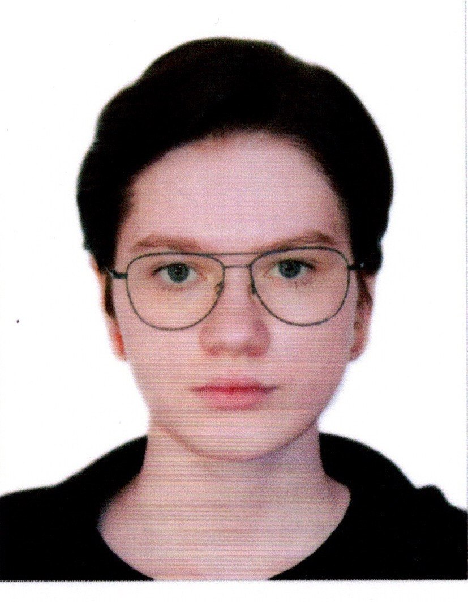

permalink: /cv
# Милана Курманова

**Студентка Санкт-Петербургского государственного университета (СПбГУ)**

## Контактная информация

- **Email:** yablonyai@mail.ru
- **GitHub:** [m1Lana888](https://github.com/m1Lana888)

## Обо мне

Я студентка первого курса Санкт-Петербургского государственного университета, обучаюсь по направлению ПИИТ.

Интересуюсь информационными технологиями и программированием. Хорошо владею языком программирования Python, умею применять полученные знания для решения практических задач.

Стремлюсь развиваться в сфере IT, расширять технические знания и получать практический опыт. Ответственно подхожу к обучению, умею самостоятельно искать информацию и работать над поставленными задачами.

## Образование

**Санкт-Петербургский государственный университет (СПбГУ)**

- Направление: ПИИТ.
- Уровень образования: бакалавриат.
- Год поступления: 2026.
- Форма обучения: бакалавриат.

## Технические навыки

- **Python** — хорошее знание языка программирования.
- Основы алгоритмизации и программирования.
- Решение практических задач с использованием Python.
- Git и GitHub — базовые навыки работы с системой контроля версий.
- Markdown — оформление технической документации.

## Проекты

**Личное CV (Curriculum Vitae)**

- Создание собственного резюме с использованием Markdown.
- Работа с Git и GitHub.
- Использование веток и коммитов.
- Публикация резюме с помощью GitHub Pages.

Исходный код: [GitHub — amcp-cv](https://github.com/m1Lana888/amcp-cv).

## Иностранные языки

- **Английский** — B1 (Intermediate).

